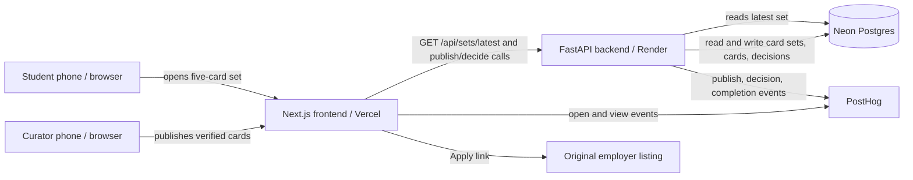

# Architecture — Prometheus / CareerCards

## The diagram

**Implementation note:** `app/lib/cards.ts` calls FastAPI `GET /api/sets/latest`; it does **not** connect directly to Neon. The same FastAPI backend handles curator publishing, session start, decision restoration, decisions and completion persistence. Browser events go to PostHog through the `/ingest` reverse proxy; FastAPI uses a durable outbox for server events.

## The stack, one line per layer

| Layer | Choice | Why this is deployable by the Week 7 gate |
|---|---|---|
| Hosting (phone UI) | Vercel, root directory `app/` | Managed Next.js deployment; deploy configuration is limited to environment variables and a GitHub connection (MG/AP own build work) |
| App framework | Next.js 15 / React (TypeScript), `app/` | Existing student and curator pages in the repo can be deployed without rewriting the UI |
| API / backend hosting | FastAPI Python, `backend/`, on Render | Routes and requirements already exist; host needs Postgres, PostHog and CORS settings |
| Database | Neon Postgres | Schema already supplied at `backend/sql/schema.sql` and database access code is present |
| Analytics | PostHog | Mandatory for course; Python server-side capture is in `backend/app/analytics.py`, browser capture is called from `app/components/StudentCardSet.tsx` |
| Messages out | None | No step requires email, SMS or WhatsApp in this MVP |
| Sign-in | No student accounts; random anonymous id; curator admin token | Five anonymous decisions require no login; publishing is protected by `ADMIN_TOKEN` on the API |

**Layers deliberately excluded from Sprint 1:** scraping, student login, outbound messages, AI matching, files/CV uploads, employer accounts.

## The journey through the stack

| Step | Layer that handles it | Event fired |
|---|---|---|
| 1 | Curator form in Next.js -> FastAPI `POST /api/publish` -> Neon `card_sets` and `cards` | `curator_publishes_card_set` (server, after write) |
| 2 | Next.js home page loads five cards through FastAPI and renders them on phone | `student_opens_card_set` (browser, once per page load) |
| 3 | Next.js card components reveal requirements, pay, hours and deadline | `student_views_card` (browser, once per card in view) |
| 4 | Apply/Skip -> FastAPI `POST /api/decide` -> Neon `decisions`; Apply also opens original listing | `student_decides_card` (server, after saved new decision) |
| 5 | FastAPI detects fifth distinct saved decision and returns apply summary to UI | `student_completes_card_set` (server, with `ms_total`) |

## Secrets and data

- **Secrets live in deployment environment settings**, locally in `backend/.env` (`DATABASE_URL`, `ADMIN_TOKEN`, `POSTHOG_KEY`, `POSTHOG_HOST`, `CORS_ORIGINS`) and `app/.env.local` (`NEXT_PUBLIC_API_URL`, `NEXT_PUBLIC_POSTHOG_KEY`, `NEXT_PUBLIC_POSTHOG_HOST` as applicable). `.gitignore` contains `.env`, `.env.*` and `app/.env.*`, with examples excepted; verified in this ZIP. No real tokens belong in commits, event properties, client-readable environment variables, or public screenshots.
- **Data:** Neon tables `card_sets`, `cards` (opportunity facts) and `decisions` (`anonymous_id`, decision, reason, time). No name, email, phone number or CV in the application data or event properties. Treat the pseudonymous id as linkable usage data, not as a real identity.
- **Curator access:** Use `/admin` with the password-style input; FastAPI checks `X-Admin-Token` on Publish. The deprecated `/admin/[token]` URL route is removed so tokens do not appear in URLs or browser history. Keep this token private and do not include it in frontend environment variables.
- **Deploy-day risk / first fix:** `app/components/StudentCardSet.tsx` imports the **existing** `@/lib/posting-client` helper. This is not a missing-file error. The actual unverified risks are Vercel `NEXT_PUBLIC_API_URL`, PostHog browser key, Render/Neon migrations, HTTPS CORS and cross-service reachability. Verify `/health/ready` and the five-decision production walk on a phone before marking the gate passed.
