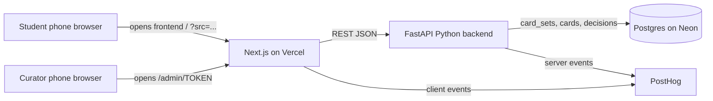

# Architecture

One diagram, one line of why per layer. The question each line answers is not "is this the best technology" but "can this team deploy it at a public URL by the Week 7 lab."

## The diagram

One public student page, one curator page (token in the URL). No accounts in Sprint 1. **API logic lives in Python** (`backend/`); the Next.js app is the phone UI only.

## The stack, one line per layer

| Layer | Choice | Why we can deploy it by Week 7 |
|---|---|---|
| Frontend hosting | Vercel | Free tier; Root Directory = `app`; MG owns the repo |
| Frontend | Next.js (App Router) | Phone UI for five cards + curator form; talks to the Python API via `NEXT_PUBLIC_API_URL` |
| Backend | FastAPI (Python 3.12) on Railway/Render/Fly | MG preferred Python; same three tables and event names; OpenAPI at `/docs` for the Week 7 demo |
| Database | Postgres on Neon | Hosted free tier; schema in `backend/sql/schema.sql` |
| Analytics | PostHog | fixed for the course; server events from FastAPI, client opens/views from the browser |
| Messages out | None | cut in `mvp-boundary.md` |
| Sign-in | None | anonymous id in localStorage; curator uses `ADMIN_TOKEN` |

**Layers we deliberately do not have in Sprint 1:** login, scraping, email/SMS/Telegram, file storage, AI matching.

## The journey through the stack

| Step | Layer that handles it | Event fired |
|---|---|---|
| 1 | Curator form → `POST /api/publish` (header `X-Admin-Token`) inserts `card_sets` + 5 `cards` | `curator_publishes_card_set` (Python) |
| 2 | Student page → `GET /api/sets/latest` then render five cards | `student_opens_card_set` (client) |
| 3 | Same page; card fields: role, company, field, source, students OK, experience, hours, pay, deadline | `student_views_card` (client) |
| 4 | Apply/Skip → `POST /api/decide`; Apply opens `source_url` in a new tab | `student_decides_card` (Python, after row saved) |
| 5 | On 5th decision, API returns apply summary with deadlines | `student_completes_card_set` (Python, with `ms_total`) |

## Secrets and data

- Frontend env (`app/.env.local`): `NEXT_PUBLIC_API_URL`
- Backend env (`backend/.env`): `DATABASE_URL`, `ADMIN_TOKEN`, `POSTHOG_KEY`, `POSTHOG_HOST`, `CORS_ORIGINS`
- Root `.gitignore` lists `.env*` and `backend/.venv/`
- Personal data we store, and where: none about a person. Table `decisions` holds `anonymous_id` (random id made by the app), `decision`, `skip_reason` (fixed list) and `ms_on_card`; tables `card_sets` and `cards` hold job-post facts only. No names, emails or phone numbers are stored or put on an event
- Deploy-day risk: Apply opens another tab before the decide request finishes — fire `student_decides_card` from the server after the insert, then open the tab (frontend already waits on `fetch` before `window.open`)
